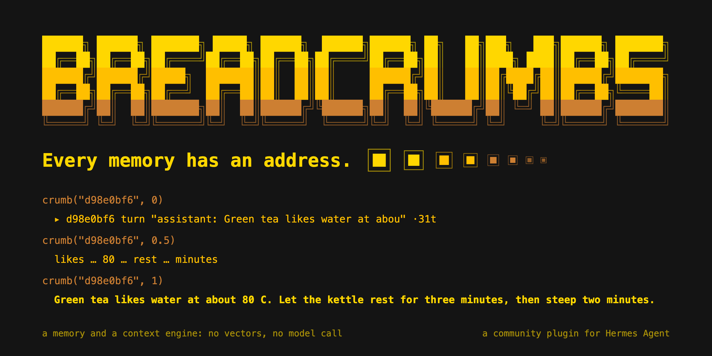
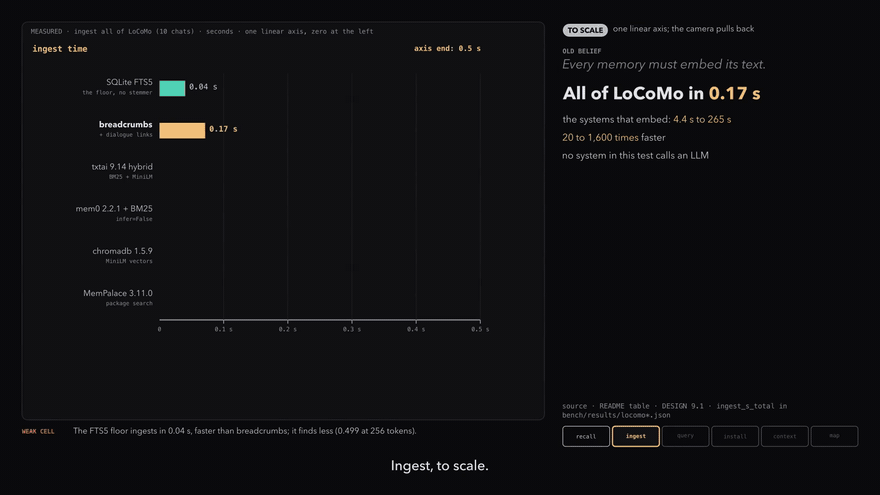
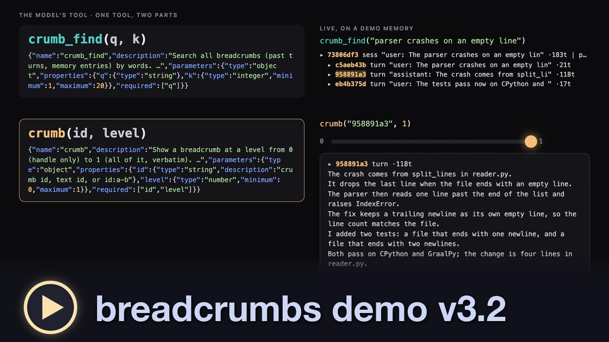
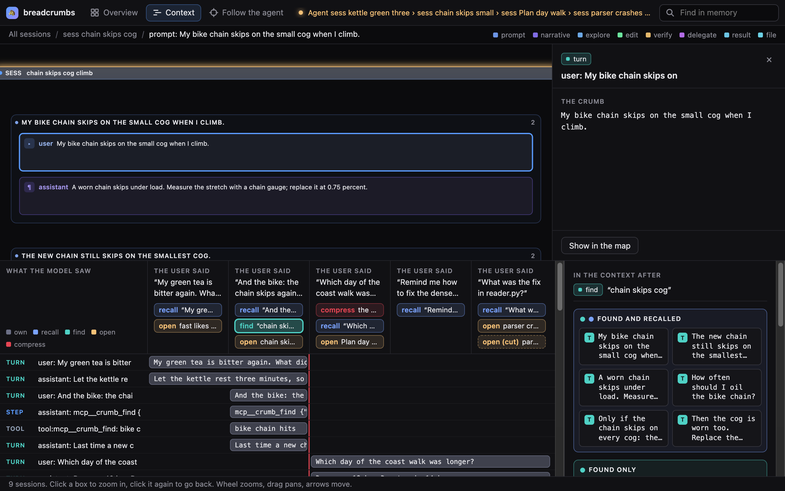

# breadcrumbs

breadcrumbs is a memory and a context engine for the Hermes agent. It keeps every fact with its exact source.
Every line has an address, and one tool shows any memory at a level from 0 (handle) to 1 (all, verbatim): `crumb(id, level)`.

```text
crumb("d98e0bf6", 0)      ▸ d98e0bf6 turn "assistant: Green tea likes water at abou" ·31t
crumb("d98e0bf6", 0.5)    likes … 80 … rest … minutes
crumb("d98e0bf6", 1)      Green tea likes water at about 80 C. Let the kettle rest for three minutes, then steep two minutes.
```

The text of these lines is real output of the demo store ([docs/DEMO.md](docs/DEMO.md); the header line of
levels 0.5 and 1 is left out here). Level 0 is a handle. Level 1
is the exact bytes. In between, a text shows its most distinct words, and each gap expands to the exact text. A
higher level never removes a word. No model writes any level.

## Watch

[](docs/media/breadcrumbs-demo-v7.mp4)

**The head-to-head, to scale** (demo v7, 65 seconds). The picture plays 12 seconds of it: click it for the full
film with sound. Each bar is on one linear axis with zero at the left, at its true ratio. Benchmark scores are a
demonstration. They are preliminary, and they vary during the hackathon.

| [](https://www.youtube.com/watch?v=a05N4Ju2-DM) |
|:-:|
| The demo (v3.2): one tool, two parts, live on a demo memory |

The first explorer, on film: [early breadcrumbs UI](https://www.youtube.com/watch?v=D3Mdd_eLjn8).

## Five facts, and what follows from each

| A fact about a model and its context | What breadcrumbs does about it |
|---|---|
| A model knows only the bytes in its window. | **Handles.** A handle is one line: an id and 8 cue words, the words that a session uses more than the rest of the memory. It is a name, inside the window, for a memory that is outside it. `crumb_find(q)` returns handles. It searches with BM25 and dialogue neighbors: no vectors, no model. |
| A copy with no address cannot be checked. | **The address is the provenance.** An id names exact bytes, in a content-addressed, append-only, compressed store: CRC32C addresses, line spines, Merkle crumbs and commits. A summary is one more crumb with a label; it never takes the place of its source. Context receipts: each recall, find, open and compaction writes an `rcpt` crumb that lists what the model saw, at which level and in how many bytes. |
| Nobody knows at write time how many bytes a question needs. | **The zoom.** The model picks the level when it reads, not when the memory is written. Below 1, a text shows key words: its first line, then its most distinct words, then its meaningful words. Grammar words show only at 1. |
| Each request pays again for every byte, unless the start of the prompt holds. | **ACE, a context engine.** A long chat folds into a layer of crumbs only when a request passes the target. The newest turns stay word for word, and the model opens any folded turn with `crumb(id, level)`. Between folds the layer does not change, so the prompt cache holds. No model call is needed. |
| The same bytes must have the same name on every machine. | **Sharing.** Public crumbs export to an IPFS CAR file. Private crumbs never leave the machine. `push` prints a CID, `pull CID` fetches it, and every store that accepts one CID holds the same crumb ids. In a hive, hosts search each other's public crumbs in a budget of milliseconds, or pass. |

## What it adds to Hermes

A prompt or a skill cannot do these. Each one is a plugin surface of Hermes.

- **A memory provider.** Recall before each turn, inside a steady-state budget: it holds context overflows at 2%
  to 5% of turns. The tools `crumb` and `crumb_find`. A receipt for each read. Tool calls and their results
  become linked `step` and `tool` crumbs.
- **A context engine** (ACE): `hermes config set context.engine breadcrumbs`.
- **`/island`**: one codebase for each profile, so that two codebases do not dilute one memory. It is a slash
  command and three hooks.
- **The explorer.** It opens a session as a document: turn frames, phase bands, tool and file cards. It draws
  the receipts as a Gantt chart (crumbs by turns; each bar holds the text that the model saw) and a Venn of
  recalled, found and opened crumbs (one frame of crumb texts for each region). It runs in a browser (`serve`),
  in Kitty or Ghostty (`term`), and as a page of Hermes Desktop.
- **Worker flows.** The skill `breadcrumbs:dispatch` tells a lead agent how to give work to a helper: the
  user's own words and the exact crumbs, not a summary of them. A helper opens a piece with `bc ID 1`, and
  its report cites the ids. The explorer draws a delegation as its own band in the turn.
- **The slot and the seats**: keep the memory provider that you have, and run it THRU breadcrumbs.
- **A CLI**: `migrate` (exports of ChatGPT, claude.ai and other memory systems become crumbs that keep their
  source ids); an Obsidian vault, both ways (`vault export DIR`, `vault import DIR`); and sharing over IPFS
  (`push`, `pull`, the hive).
- Heuristics first. A small local model (Qwen3.5-0.8B through llama.cpp, no server) writes `sum` crumbs only.
  Each summary records its source, the model file hash and the exact model input.
- The Python standard library and one package, `google-crc32c` (the CRC32C as a CPU instruction). It
  runs on CPython 3.11+ and on GraalPy 25; without the package, a pure-Python CRC32C gives the same ids.

## What is measured

Benchmark scores are a demonstration. They are preliminary, and they vary during the hackathon.

Against other memory systems, on the same data and with no LLM and no judge. LoCoMo:
1,981 questions; the score is the share of gold turns inside a context of 256 or 4,096 tokens.
On LoCoMo it beats MemPalace, txtai, mem0 and chromadb at every budget.

| system | 256 | 4,096 | ingest | query p50 | disk | install |
|---|---:|---:|---:|---:|---:|---:|
| **breadcrumbs** (BM25 + neighbors) | **0.583** | **0.876** | **0.17 s** | 1.6 ms | **2.8 MB** | **0** |
| mem0 2.2.1 (infer=False + BM25) | 0.551 | 0.867 | 47 s | 22 ms | 31.1 MB | 1,016 MiB |
| txtai 9.14 hybrid (BM25 + MiniLM) | 0.516 | 0.863 | 4.4 s | 10 ms | 16.3 MB | 751 MiB |
| MemPalace 3.11.0 (package search) | 0.515 | 0.854 | 265 s | 64 ms | 44.7 MB | 341 MiB |
| chromadb 1.5.9 (MiniLM) | 0.335 | 0.768 | 134 s | 82 ms | 24.6 MB | 334 MiB |
| SQLite FTS5, no stemmer (the floor) | 0.499 | 0.744 | 0.04 s | 0.4 ms | 2.2 MB | 0 |

- The install column is the size of the packages that a system needs. breadcrumbs needs one small package,
  `google-crc32c`.
- The neighbor weight was chosen on LoCoMo. On LongMemEval-S, which was not used to tune, breadcrumbs
  also beats the FTS5 floor.
- Session handles end with 8 cue words. BM25 over one handle per session ranks the session that holds the
  answer first for 38% of LoCoMo and 55% of LongMemEval-S questions (5% and 18% without the cue words).
- The context engine. A replay of this project's own chat (4,697 messages) has its largest request at
  2,332,831 tokens without ACE and at 164,350 with it (tokens here are request bytes / 4), and 3,961 of the
  3,968 crumbs of its last layer open to their exact message.
- Two limits. At a target of 8k or 16k tokens a plain window holds more exact text than ACE, and a summary by
  the small model can be wrong. So a summary has a label, and its sources stay exact.



## Try it in sixty seconds, with no model and no network

Run these from a clone of this repository, or from the installed plugin folder (`$HERMES_HOME/plugins/breadcrumbs`).

```sh
python3 demo/seed.py /tmp/bc-demo                                               # a memory with neutral text; the same ids on each run
python3 -m breadcrumbs --home /tmp/bc-demo/breadcrumbs find "green tea kettle"  # search: handles, each under its session
python3 -m breadcrumbs --home /tmp/bc-demo/breadcrumbs bc d98e0bf6 0.5          # one memory at level 0.5; try 0 and 1
python3 -m breadcrumbs --home /tmp/bc-demo/breadcrumbs verify                   # check every CRC32C
python3 -m breadcrumbs --home /tmp/bc-demo/breadcrumbs serve --open             # the explorer, read-only
```

[docs/DEMO.md](docs/DEMO.md) tells what the explorer shows. To see your own Hermes sessions, install the plugin
(the next section) and backfill a profile. The backfill reads `state.db` read-only.

```sh
python3 -m breadcrumbs --home ~/.hermes/breadcrumbs ingest-hermes default       # then: ... --home ~/.hermes/breadcrumbs serve --open
```

## Install

```sh
hermes plugins install breadcrumbs-agency/hermes-breadcrumb-plugin   # the repository is the plugin
hermes config set memory.provider breadcrumbs       # undo: hermes memory off
```

The plugin declares one dependency, `google-crc32c`, so the install asks one dependency question, and
Hermes installs the package into its environment. The CRC32C then uses the CPU instruction. In a Python
without the package (and on GraalPy), a pure-Python CRC32C runs and gives the same ids.

Summaries are optional. They need llama.cpp's `llama-completion` on the PATH and a GGUF model.
The default is Qwen3.5-0.8B (Apache-2.0, 580 MB), the best of ten local models up to 1.5B on the
summary bench:

```sh
curl -L -o ~/models/Qwen_Qwen3.5-0.8B-Q4_K_M.gguf \
  https://huggingface.co/bartowski/Qwen_Qwen3.5-0.8B-GGUF/resolve/main/Qwen_Qwen3.5-0.8B-Q4_K_M.gguf
shasum -a 256 ~/models/Qwen_Qwen3.5-0.8B-Q4_K_M.gguf   # fb044e93939a70469c905781334f5de1e6c8b608ced6cbc8c9249bd4127d9526
```

`BREADCRUMBS_SUM_MODEL` picks another file and `BREADCRUMBS_SUM_TEMPLATE` its chat family (qwen,
chatml, nemotron, granite, gemma3, gemma4). Without a model, everything else works and no summaries
are written.

`hermes memory setup` offers one field, `turn_factor` (default 0, off). Above 0, recall, find and open
share one memory budget for each user turn: that many times the recall budget. A full turn cuts find
to handles and open to a lower level, and the result says so. The value is kept in
`$HERMES_HOME/breadcrumbs/config.json`; `BREADCRUMBS_TURN_FACTOR` overrides it. In a live A/B, the
answers with the budget were less complete, so the default stays off.

### Keep your old memory system: the slot

Hermes runs one external memory provider. The slot lets you keep the one you have (mem0, Honcho,
Supermemory, Hindsight, ...) and add breadcrumbs:

```sh
python -m breadcrumbs slot <profile>           # the profile's provider moves into the slot; breadcrumbs takes its place
python -m breadcrumbs slot <profile> honcho    # or name the provider
python -m breadcrumbs slot <profile> --off     # undo: the slotted provider is the memory provider again
```

Each call goes THRU breadcrumbs to the slotted provider: Hermes gets its recall, tools, prompt block
and recall line as before, byte for byte. breadcrumbs stacks under it. It adds nothing to the context
(with ACE on, it adds `crumb` and `crumb_find`: the ACE layer needs them). It keeps each turn and each
text that the slot recalls as a `slot` crumb with its source and a receipt, and these stay after
`--off`. A slot that fails is logged in `provider.log` and skipped. The name is kept in `config.json` (`hermes memory
setup` offers it too). Restart the gateway after a change.

### Other memory systems: seats

Each memory system is a different case. breadcrumbs reuses a provider that Hermes has (in the slot),
clones one that Hermes took out of its core (from Hermes's own git history, with the commit and the
SHA-256 of each file), or borrows the files of one that it does not run. For each system it adds
permanence (`seat snap`, `seat harvest`) and mobility (`seat restore`, `seat replay`, and a CAR file):

```sh
python -m breadcrumbs seats <profile>                       # each system: its way, where it is, its files
python -m breadcrumbs seat clone holographic <profile>      # back from Hermes's history into plugins/
python -m breadcrumbs seat snap holographic <profile>       # the exact bytes of its state
python -m breadcrumbs seat harvest builtin <profile>        # each entry of MEMORY.md and USER.md as a crumb
python -m breadcrumbs seat restore holographic <profile-2>  # the state in another profile
python -m breadcrumbs seat replay holographic <profile> --from seat-builtin   # kept texts into a system
```

### Keep the context at a steady size: ACE

The size of a request counts its text, its tool calls and the thinking that goes back with each message,
and the model's own counts turn bytes into tokens. One turn can fold its own first steps. On a live run
with a 50k target, one turn of 16 calls stayed at 21,437 to 51,288 tokens (67,588 for one step that read
three files at once), with 9 folds, 0 API errors and an exact answer. Each request writes one line to
`$HERMES_HOME/breadcrumbs/ace.log`.

```sh
hermes -p <profile> config set context.engine breadcrumbs   # back: ... context.engine compressor
```

Hermes then sends each request through the breadcrumbs context engine. When a request passes 200k
tokens, the older turns fold into a layer of crumbs, each at a level from 0 to 1, and the newest turns
stay word for word. The model opens a crumb with `crumb(ref, level)`, and the next layer gives that
crumb more room. No model call is needed.

Between folds the layer does not change, so the prompt cache holds: a request pays again for the new turns
only. This README states no multiplier for that gain. A plain window of the newest messages holds more exact
text than the layer at a target of 8k or 16k tokens. At a target of 16k tokens or less, the layer is smaller
(15% of a fold, not 40%), because there exact text recalls more.

The fold numbers (the 200k target, the 10% cut, the ratchet and the layer share) are preliminary
engineering parameters. They may change during the hackathon.

### Knobs and dials

Every knob is one row below. `python -m breadcrumbs --home <HERMES_HOME>/breadcrumbs dials [--model NAME]`
shows each dial with its value and where the value came from (the default, `config.json`, a model entry or the
environment), names a value that is not valid, and names a key that is no dial (a typing mistake). A dial is set in
`$HERMES_HOME/breadcrumbs/config.json`. Each profile has its own file, so profiles differ in one gateway.
`"models"` maps a glob of the model name to dials: no one set is best for each model, because a model
at maximum reasoning writes more thinking, and the thinking that goes back with each message counts in each
request. The last value that sets a dial wins; the environment variable of a dial wins over the file. A
`"models"` entry may also hold request options (`temperature`, `top_p`, ...). This release does not send them,
because it replaces no code of Hermes; the file keeps them, and `dials` names them.

```json
{"ace_tokens": 200000, "models": {"*nemotron*": {"ace_tokens": 290000, "ace_fold_to": 0.9}}}
```

**The size of the context.** ACE keeps a chat near `ace_tokens`. A model that reads a lot of data needs more room,
and nothing stops it but Hermes's own threshold: when an interval of reading passes the target, the target grows by
`ace_ratchet`, so the data stays in one place (fewer folds, fewer layers). When the tools work without growing the
context (a write, or `ace_diverse` different tools in an interval), each interval takes the fold share, 10% at
`ace_fold_to` 0.9, off the room above `ace_tokens`, until the target is back at the band. A fold then cuts 10% off
the target, as always. Before the taper, one chat went from 200k to 609,725 and was not folded for 450,000 tokens.

| Dial | Default | Range | Env var | What it does |
|---|---|---|---|---|
| `ace_tokens` | 200,000 | 1 or more | `BREADCRUMBS_ACE_TOKENS` | The normal size in tokens at which ACE folds a chat. Reading may grow the target above it; work tapers it back to it. |
| `ace_fold_to` | 0.9 | 0.1 to 1 |  | A fold leaves the request at this share of the target: 0.9 cuts 10%, 20k at a target of 200k. The same 10% tapers a raised target back to ace_tokens, one step in each interval of work. |
| `ace_fold_cap` | 1.35 | 0.1 to 2 |  | A fold aims at most at this share of the target, by the estimate (the estimate reads high). |
| `ace_ratchet` | 1.45 | 1 to 4 |  | A fold interval in which the tools only read raises the target by this factor, so that a model that reads a lot of data keeps it in one place (fewer folds, fewer layers). There is no ceiling but Hermes's threshold. 1.0: never. |
| `ace_diverse` | 4 | 0 or more |  | An interval in which the tool calls write, or use this many different tools, is work and not reading: the raised target tapers back. 0: only a write counts. |
| `prefetch_tokens` | 300 | 1 or more | `BREADCRUMBS_PREFETCH_TOKENS` | The first budget of the recall text in each turn, in tokens. The controller then adapts it, between budget_min and budget_max (it is saved in horizon.json). |
| `recall_share` | 0.15 | 0 to 1 | `BREADCRUMBS_RECALL_SHARE` | A turn overflows when the recall text is more than this share of the context. |
| `neighbor` | 0.3 | 0 to 1 | `BREADCRUMBS_NEIGHBOR` | The weight of dialogue-neighbor smoothing in search: a turn next to a strong hit gets this share of the hit's score. 0: off. |
| `turn_factor` | 0 | 0 to 64 | `BREADCRUMBS_TURN_FACTOR` | One memory budget for each user turn: recall, find and open share this many recall budgets. 0: no turn budget. |
| `age_half_days` | 30 | 0.1 or more | `BREADCRUMBS_AGE_HALF_DAYS` | The priority of a crumb in recall halves in this many days of age. |
| `idle_half_days` | 7 | 0.1 or more | `BREADCRUMBS_IDLE_HALF_DAYS` | And it halves in this many days since the model last opened it. |
| `budget_min` | 40 | 1 or more |  | The smallest recall budget that the controller sets, in tokens. |
| `budget_max` | 2,000 | 1 or more |  | The largest recall budget that the controller sets, in tokens. |
| `overflow_low` | 0.02 | 0 to 1 |  | The controller raises the budget when fewer turns than this share overflow. |
| `overflow_high` | 0.05 | 0 to 1 |  | The controller lowers the budget when more turns than this share overflow. |

| Environment knob | Default | What it does |
|---|---|---|
| `BREADCRUMBS_HOME` | <HERMES_HOME>/breadcrumbs | The directory of the store, for the command line. |
| `BREADCRUMBS_TOOL_PREFIX` | mcp__ | The prefix of the tool names (`mcp__crumb`). Hermes on the Anthropic OAuth wire needs it. |
| `BREADCRUMBS_SLOT` | (none) | The name of another memory provider to run through breadcrumbs. Wins over config.json "slot". |
| `BREADCRUMBS_SUMMARIZE` | auto | `0`: never run the small summary model. `auto`: run it when the model and the binary exist. |
| `BREADCRUMBS_SUM_MODEL` | ~/models/Qwen_Qwen3.5-0.8B-Q4_K_M.gguf | The GGUF file of the summary model. |
| `BREADCRUMBS_LLAMA` | llama-completion on the PATH | The llama.cpp binary that runs the summary model. |
| `BREADCRUMBS_SUM_TEMPLATE` | qwen | The prompt template of the summary model. |
| `BREADCRUMBS_CRC32C` | (auto) | `pure`: use the pure-Python CRC32C even when google-crc32c is installed. |
| `BREADCRUMBS_GRAALPY` | (auto) | The GraalPy binary for the GraalPy runs. |
| `BREADCRUMBS_GRAAL_HEAP` | 4g | The heap of a GraalPy run. |
| `BREADCRUMBS_IPFS` | ipfs on the PATH | The kubo binary, for `push`, `pull` and the hive. |
| `BREADCRUMBS_HERMES_REPO` | ~/.hermes/hermes-agent | The Hermes checkout that `seat` commands read. |

`python -m breadcrumbs --home <HERMES_HOME>/breadcrumbs ace` shows the size of each chat against its target
(from `ace.log`; read-only). A model sees only its own context, not the size of it.

### Bring your memory along: migrate

`python -m breadcrumbs migrate SYSTEM FILE` reads another system's export into the store. Each crumb keeps
the record's id in that system (`meta.src`, `meta.src_id`), so a recalled fact names its source. A
conversation becomes a session; a memory list becomes one session of `mem` crumbs per system. A second
run adds nothing.

| SYSTEM | FILE |
|---|---|
| `chatgpt` | `conversations.json` of an OpenAI data export (the visible branch of each conversation) |
| `claude` | `conversations.json` of a claude.ai data export |
| `hermes` | a profile's `MEMORY.md` or `USER.md` |
| `mem0`, `openmemory`, `supermemory`, `hindsight`, `honcho`, `retaindb` | the JSON list that the system's list API returns |

### Give work to a helper: the dispatch handbook

The plugin ships a five-line skill with its tools: `breadcrumbs:dispatch` (`breadcrumbs/skills/dispatch/SKILL.md`).
Hermes lists it with the other skills, and the prompt block names it. It tells an agent how to give work
to a `delegate_task` child, a `message_agent` teammate or a cron job: send the user's own words and the
exact crumbs (level 1, or an `id:a-b` range), not a summary in the agent's own words. A child has no
memory tools, so the handbook gives it `bc`, which only reads the store.

### One codebase per profile: islands

A profile has one memory. Two codebases in one chat dilute the context: the chat holds the text of both,
and recall can bring back a crumb of the wrong codebase. The purpose of `/island` is to keep the context
from losing the benefits of breadcrumbs through dilution. It gives a codebase its own profile, so each
profile works in one codebase. breadcrumbs has no measurement of this dilution yet.

breadcrumbs finds the codebase of each tool call: the git repository under your home folder that holds
the call's path. A worktree or a submodule counts as its main repository. Hermes's own files, repositories
in hidden folders (`~/.pyenv`) and folders outside your home folder are not codebases. When the profile's
`terminal.cwd` is in a codebase, that codebase is the island of the profile.

- **The offer.** When a chat makes 3 calls in a codebase that is not the island of its profile, its next
  reply ends with a red offer. A profile with no island (the default profile, for example) gets the offer
  at the first call in its first codebase, in the first reply that follows. With no tool call yet, the
  first reply carries it for the codebase of the launch folder (0 calls). A profile with an island gets it
  at a second codebase. The offer names the
  codebases and gives one command: `/island PATH`, or `hermes -p NAME` when another
  profile has that codebase as its island. A chat gets the offer one time for each codebase. The offer
  changes nothing by itself.
- **The handoff.** In a chat, `/island` asks first in a modal picker (Yes / No), then gives the codebase that Hermes was launched in its own profile and asks Hermes to end the chat (`/quit`, best effort); only a Yes acts. A PATH skips the question. A chat that starts inside the island of its profile gets one NOTE at its first reply with the ways to open the visualizer (the desktop map item, `term` in Kitty or Ghostty, `serve --open` in a browser). A messaging-gateway chat (Telegram, Discord, ...) gets a disclaimer instead: use a local session or `hermes islands island PATH`.
  `/island PATH [NAME]` names another codebase or another profile name. The
  `terminal.cwd` of that profile is the root of the repository. The answer gives the command that
  continues the work there: `hermes -p NAME`.
- **The checks.** `/island status` shows the island of this profile, the islands of all profiles,
  the problems of each island, and the codebases of this profile's own tool calls. `/island --all` gives
  the island of each profile and the codebases of its tool calls, with a verdict.

```sh
python3 -m breadcrumbs sources PROFILE   # the codebases of the profile's past tool calls: calls, chats, last use
```

The new profile is a clone of the profile that runs the command. Hermes's own CLI makes the clone and
sets its `terminal.cwd`. When a profile with the default name exists and has no island, it gets the
island (its `terminal.cwd`); `/island` makes no second profile. breadcrumbs
needs no other plugin for `/island`. Hermes also copies the folder of the memory provider into a clone,
so a new island starts with a copy of the breadcrumbs store of the old profile.

### Performance and safety: the turbo and the gear

A race car driver wears a helmet and gear, because performance comes with danger. breadcrumbs is the
turbo on token effectiveness, and it brings its own helmet and gear. Each part of the turbo has a
danger. breadcrumbs gives each danger a guard and a signal.

| Turbo | Danger | Guard in breadcrumbs | Signal |
|---|---|---|---|
| ACE folds older turns into crumbs. Between folds the layer does not change, so the prompt cache holds. | Below level 1, the model sees key words, not the exact text. At 8k and 16k, a plain window holds more exact text. | Each crumb keeps its exact text, and `crumb(id, 1)` gives it back. At 16k or less, the layer takes 15% of a fold. | `ace.log`: one line per request |
| Recall and the `crumb` tools bring past text back as crumbs. | The model can open the wrong crumb, or no crumb. | Each event is a receipt: the refs, levels and bytes that the model saw, in a hash chain. | `rcpt` crumbs |
| A small model writes summaries. | A summary can be wrong. | A `sum` crumb keeps the model's SHA-256 and the exact prompt. Its sources stay exact. | `sum` crumbs |
| The hive searches other hosts. | Text from another host comes into the context. | Each part must pass its CRC32C check. A late peer passes. The id names the peer. | receipts with `id@peer/store` |
| One memory per profile | Two codebases in one chat dilute the context and mix their recall. | A red offer at the 3rd call. `/island PATH` gives the codebase its own profile. | `islands.json` |
| ACE raises its target when the tool calls only read. | A larger target costs more tokens in each request. | Only a fold interval with no work raises the target (by 1.45), up to Hermes's threshold. An interval with work folds as before. | `act=ratchet` in `ace.log` |

Each signal is a file (`ace.log`, `islands.json`) or a crumb (`rcpt`, `sum`) that you can read.
`/island` is a command of breadcrumbs.

## What it does on your machine

- It keeps its data in `$HERMES_HOME/breadcrumbs/`, the store of the active profile.
- It keeps each user, assistant and tool turn word for word, append-only. Hermes hands a turn to the provider
  after Hermes has masked secrets in it (Hermes's own scrubber, `_redact_for_provider`). breadcrumbs masks
  nothing itself, so a secret that the scrubber misses is kept. The context engine keeps the text of the
  messages that it folds (a tool result and the arguments of a call as plain text). `ingest-hermes` copies the
  user, assistant and tool rows of `state.db` as Hermes stored them.
- By default, breadcrumbs makes no network calls. It reads no credential files. It sends no telemetry. A
  slotted provider (see the slot) works as it did before, with its own network calls.
- It replaces no class and no function of Hermes.
- The hive is off by default. When `config.json` lists `hive` peers, `crumb_find` also sends its
  query to each listed peer address (TCP) and waits at most a budget (150 ms by default). `crumb` on
  a hit `id@peer/store` gets that crumb from its peer. A peer answers from public crumbs only, unless
  its owner serves a store whole (`hive serve --all NAME`, CLI only).
- One background thread writes summaries after a span or a session closes, never during a model
  turn. It runs the local `llama-completion` binary as a subprocess and reads the model file once
  to record its SHA-256. The subprocess gets a minimal environment: `PATH`, `HOME`, `LANG`, `TMPDIR`,
  and the `LC_*`, `LLAMA_*`, `GGML_*` and GPU variables, never a name with KEY, TOKEN, SECRET or
  PASSWORD (`summarize.child_env`). `BREADCRUMBS_SUMMARIZE=0` turns this off.
- `/island` asks first, in a Yes or No picker. After a Yes, it runs `hermes profile create NAME --clone-from
  CURRENT` and `hermes -p NAME config set terminal.cwd PATH` as child processes (stdin closed, 300 seconds at
  most for each), and then asks Hermes to end the chat with `/quit`. The clone copies the keys, the plugins and
  the memory files of the profile that it comes from. A profile that exists and has no island gets only the
  `config set`. `/island PATH` skips the question.
- It writes `islands.json` in the store folder: for the newest 64 chats, the codebases of their tool calls, with
  counts. `post_tool_call` reads the paths in the arguments of each tool call. `on_session_start` reads the
  folder that the chat started in. `transform_llm_output` adds the offer to a reply when the chat mixes
  codebases (and, one time, a note on the ways to open the explorer when a chat starts in its island).
- The island checks (`/island status`, `/island --all`) read the `config.yaml` of the profiles (their
  `terminal.cwd` and `memory.provider`) and look in the `plugins` folder of a profile for this plugin.
  To count the codebases of past tool calls, `/island status` reads the `state.db` of this profile,
  `/island --all` the `state.db` of every profile, and `sources PROFILE` that of one profile (all read-only).
- The dashboard API (the Desktop page) is read-only, and the dashboard's session secret guards it. It reads the
  store of the active profile. A request with `store=NAME` reads the store, or the `state.db` for the log
  views, of another profile of the same Hermes root, and `/stores` lists those stores with their paths and
  session counts. The API starts one warm-up thread when it loads: the thread opens the store of the active
  profile once.
- With a slot, breadcrumbs reads the settings files of the slotted provider (`$HERMES_HOME/<name>.json` and
  `$HERMES_HOME/<name>/config.json`) and the `memory` section of `config.yaml`, to show the setup fields of
  that provider. When you save that setup and the provider has no `save_config` of its own, breadcrumbs writes
  `memory.<name>` in `config.yaml`. `python -m breadcrumbs slot PROFILE` sets `memory.provider` through
  `hermes config set`.
- The CLI command `ingest-hermes PROFILE` reads that profile's `state.db` (read-only). The memory provider
  does not read it.
- `share` and `import` write and read CAR files only at the paths you give. No IPFS daemon runs.
- `push` and `pull` (CLI only) run your local `ipfs` binary (kubo) with your `IPFS_PATH`; what it
  connects to is your kubo configuration. `push` adds only the public crumbs of one project.
- `serve` (CLI only) starts a read-only page on 127.0.0.1 with a token in the URL. The provider
  opens no port.
- `term` (CLI only) draws the same explorer page in Kitty or Ghostty through the Kitty graphics
  protocol. Each frame, headless Chrome (a scratch profile, never yours; `BREADCRUMBS_CHROME` picks the
  binary) takes a PNG of the page, and the terminal shows it in place of the last one. With no `--url`,
  it serves `--home` on a free 127.0.0.1 port first. Options: `--every S` (default 10), `--width`,
  `--height`, `--wait-ms` (page time for its API calls), `--frames N`. Ctrl-C clears the image.
- The `seat` commands (CLI only) write outside the store only when you run them: `clone` writes
  `plugins/<name>` from your local Hermes git checkout, `restore` writes the files of a snap, and
  `replay` runs the other provider, with its own network calls.

## Use

```sh
python3 -m breadcrumbs --home DIR find "zoom level"        # search
python3 -m breadcrumbs --home DIR bc 4fe224dc 0.3          # show a crumb at level 0.3 (read-only: safe while a gateway runs)
python3 -m breadcrumbs --home DIR bc 4fe224dc:1-7 1        # the exact lines 1..6 of a text
python3 -m breadcrumbs --home DIR log                      # the commit chain
python3 -m breadcrumbs --home DIR stats                    # sizes and ratios
python3 -m breadcrumbs --home DIR verify                   # check every CRC32C
python3 -m breadcrumbs --home DIR summarize --all         # small-model summaries of sessions and closed spans
python3 -m breadcrumbs --home DIR publish 4fe224dc         # a public copy (the original stays private)
python3 -m breadcrumbs --home DIR share ID --out x.car     # export public crumbs (IPFS CAR)
python3 -m breadcrumbs --home DIR import x.car             # import shared crumbs
python3 -m breadcrumbs --home DIR project NAME REF          # add a public copy of a crumb to a shared project
python3 -m breadcrumbs --home DIR push NAME                 # add the project head to IPFS (kubo); prints the CID
python3 -m breadcrumbs --home DIR pull NAME CID             # fetch a project head by CID and join it
python3 -m breadcrumbs install-hermes PROFILE              # add the provider to a Hermes profile
python3 -m breadcrumbs --home DIR ingest-hermes PROFILE    # backfill a profile's sessions (read-only)
python3 -m breadcrumbs --home DIR prune-index              # drop index rows of crumb/crumb_find calls made by older versions
python3 -m breadcrumbs --home DIR serve --open             # the explorer on 127.0.0.1 (read-only, token in the URL)
python3 -m breadcrumbs --home DIR term                     # the explorer in Kitty or Ghostty (Kitty graphics)
```

## Test

```sh
python3 -m unittest discover -s tests                      # CPython
graalpy -m unittest discover -s tests                      # GraalPy
<hermes venv python> tests/hermes_integration.py           # through Hermes's own MemoryManager
```

## License

MIT, the same license as Hermes Agent. See [LICENSE](LICENSE).
