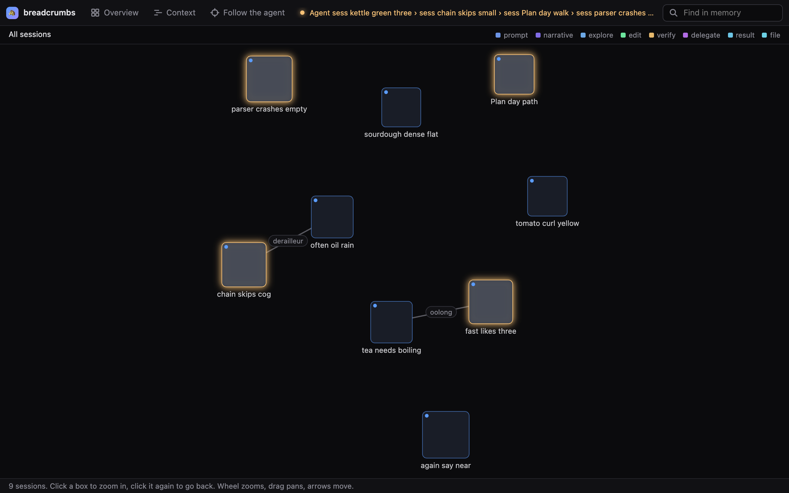
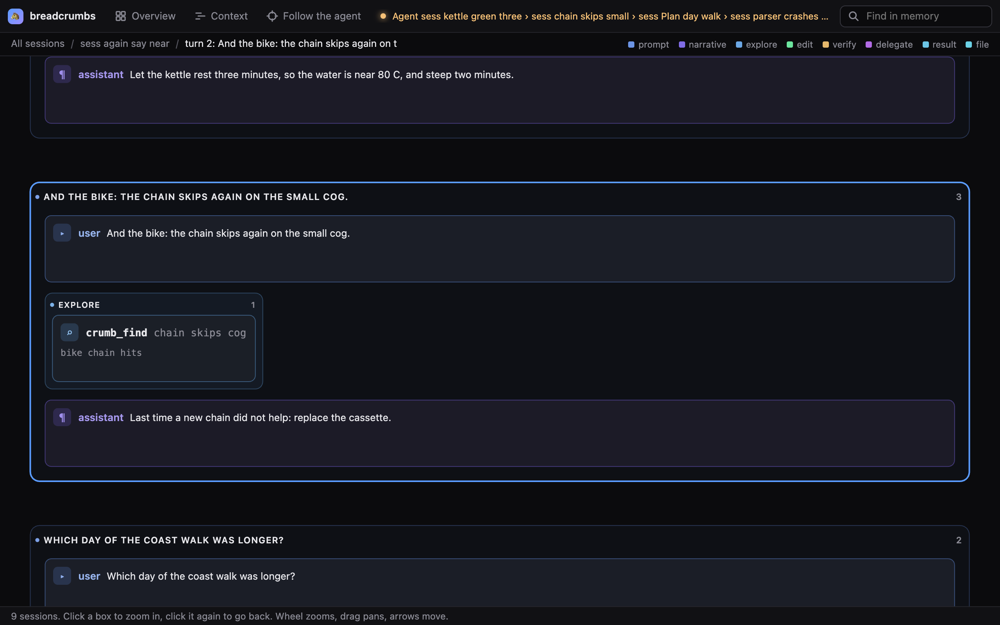
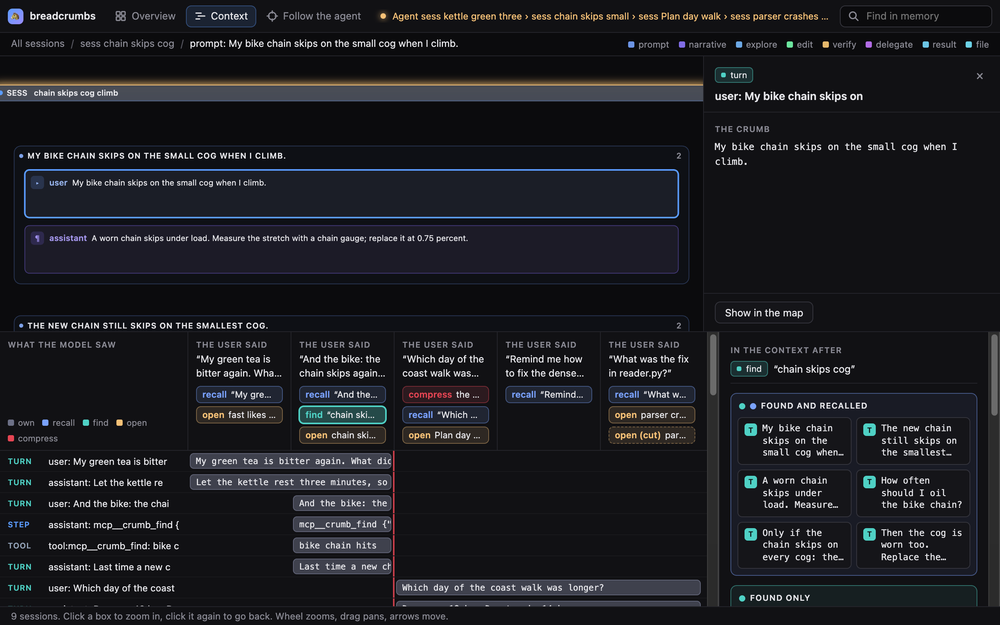

# The breadcrumbs demo

This page tells how to run the demo and what it shows. It also holds the script for the 88-second
film. The demo needs no model and no network.

## Run it

```sh
python3 demo/seed.py /tmp/bc-demo                                  # a memory with neutral text
python3 -m breadcrumbs --home /tmp/bc-demo/breadcrumbs serve --open # the explorer, read-only
```

The seed writes eight past sessions (tea, bike, garden, a parser fix, a coast walk, bread) and one
session, `today`. In `today`, the agent recalls, finds, opens and compacts over four turns. A fifth
turn runs under a turn budget: the agent opens the parser session at level 0.3 and then at level 1,
and the budget cuts the second open. The times are fixed, so two runs give the same store.
`tests/test_demo.py` checks what the views show.

## What you see

**The map.** Each box is a session. A box's label is its first three cue words: the words that the
session uses more than the rest of the memory. Two sessions that share a cue word pull together, and
the line between them names the shared word (`oolong`, `derailleur`). A glow marks a session that
the agent opened.



**The zoom.** A click on a box opens its session as a document. Each user turn is a frame, headed by
what the user said. In the frame, the
prompt and the answers are cards, and each run of tool calls of one phase (explore, edit, verify,
delegate) is a band of tool cards. The files that the tools read and wrote are cards too, with a
line to each call that touched them. A click zooms to a frame, a band or a card. A card shows
`crumb(id, level)` at the level that its area can hold. Below level 1, a text shows key words: its
first line, then its most distinct words, then its meaningful words. Grammar words show only at
level 1. A `…` marks a gap; the gap expands to the exact text. In this picture, the bike turn of
`today` has the prompt, the agent's `crumb_find` call in an explore band, and the answer.



**The context.** Click "Context". The Gantt chart has one row for each crumb and one column for each
user turn. The head of each column gives what the user said in that turn. A bar is one copy of a crumb
in the model's context, and it shows the text that the model saw at the level of that copy. Its color
tells what put it there: gray is the session's own turns, blue is recall, teal is find, orange is open,
and red is the compaction (the red line marks it). A legend is at the top left. Under the head of each
turn, a chip names each event of the turn by its query or by the crumb that it opened. A dashed chip
marks an event that the turn budget cut: the last turn ran under a turn budget, and the budget cut
its second open. A click on a chip shows the Venn at that event. The Venn has one frame for each
region (found and recalled, found only, and so on), and each crumb in the region shows as its text.
A click on a bar, a chip or a crumb puts its text in the side panel and zooms the map to it. For a
chip, the side panel gives the exact context that the event gave the model. The context box stays on
its session until you click the map. The charts give no byte counts; `View.context` and `View.venn`
still give the bytes, for charts that draw them.



**The size.** Click "Size" (or put `#size=1` in the URL). The panel draws `ace.log`, the record that the
context engine writes for each request. A line chart shows what the chat holds, what ACE sent, the model's
own count and the target, with a dot on each fold. Candles show the sent size; a candle that ends lower is a
fold. A pie shows the parts of one request: the fixed part, the layer, the exact turns, and what is held back,
one crumb call away. A histogram shows how much each fold cut. Pills pick the selected session or the
current one. The seeded store has no `ace.log`, so the panel is empty there: it draws a profile that ran
with `context.engine breadcrumbs`.

## The 88-second film

The film shows facts about a model and its context, and what breadcrumbs does about each (the README has
five of them). Every shot is real footage: the real page, the real Hermes, the real terminal. Each number on the
screen is read from a file or a log that is in the shot. Record at 1920 x 1080. The voice lines are in
Simplified Technical English. The captions alone must tell the film, because a film on X plays with no sound.

| Time | Screen | Caption | Voice |
|---|---|---|---|
| 0:00-0:11 | The explorer, in motion at the first frame: one dive from all sessions to one session, one turn, one card. The text of the card grows from cue words to exact lines. | Every memory has an address. | No vector database. Recall needs no model. Every line that Hermes remembers has an address. Zoom in: a handle becomes key words, then the exact text. |
| 0:11-0:18 | A Hermes chat with the provider on, beside the explorer with "Follow the agent". The `mcp__crumb_find` call, the `mcp__crumb` call, and the answer with a crumb id. The map moves to that crumb. | One call: crumb(id, level). | The model opens any memory with one call: crumb, id, level. The answer cites the address. |
| 0:18-0:26 | Click "Context". The Gantt bar of that crumb. Click its `open` chip: the side panel gives the text that the model saw. | It records what the model saw. | Each read writes a record: the crumb, the level, the bytes that the model saw. |
| 0:26-0:40 | A lead agent gives work to three helpers. The delegate band of its turn; each brief with the user's words and its crumb ids; a helper runs `bc ID 1`; the reports cite the ids. | Give a worker the pieces, not a story. | A lead agent gives each worker the user's own words and the exact crumbs, not a summary. The worker opens each piece at level 1. Its report cites the addresses. |
| 0:40-0:52 | Click "Size" on a chat that ran with ACE: the line climbs to the target, the folds, the candles, the pie. | No model writes the fold. | A long chat fills the window. ACE folds old turns into crumbs, with no model call. Between folds the layer does not change, so the cache holds. |
| 0:52-1:04 | Two terminals, one for each IPFS node. `project` and `push` on the first; `pull` with the CID on the second; the same head id on both. | Same bytes. Same name. | Two IPFS nodes on a private swarm. Node A pushes a project. Node B pulls it by its CID alone: the same head id. |
| 1:04-1:11 | `/island` in a Hermes chat on a throwaway repository: the offer, Yes, the line `hermes -p NAME`. | One codebase. One memory. | /island gives each codebase its own Hermes profile, so recall stays on one codebase. |
| 1:11-1:20 | A terminal prints the bench rows from the README, then the install lines. | No LLM. No judge. Run it. | Five systems. The same questions. No judge. |
| 1:20-1:26 | A dark card: the word breadcrumbs, `crumb(id, level)`, the repository and the commit. | Give every memory an address. | Breadcrumbs. Memory with exact provenance. |

The real footage plays in one panel of the frame. Round it are a border and a strip: the caption of the shot, its
source, and a thread that grows with the film, with one crumb for each shot. The voice can use takes of earlier
films that say the same facts in other words.

Before you record:

- Seed the demo store and start `serve` on it (see "Run it"). Show only a store whose text may be public: the
  demo store, or a profile that has worked only on public files.
- For the chat step, use a profile with the provider on (`memory.provider breadcrumbs`). Do not write the
  model's text for it. If the model does not call `crumb`, show `find` and `bc ID 0`, `bc ID 0.5`, `bc ID 1`
  in a terminal.
- For the Size step, the profile needs `context.engine breadcrumbs` and a chat that is longer than its target.
  Each number on the screen comes from the `ace.log` line of that chat.
- For the worker step, the lead reads the skill `breadcrumbs:dispatch` first. Keep a take only when each
  brief holds the user's words and a crumb id, and a helper opens a piece.
- For the IPFS step, start kubo on both nodes with one private network key. The `push`
  and `pull` commands are in the README.
- Watch the film one time with the sound off.
